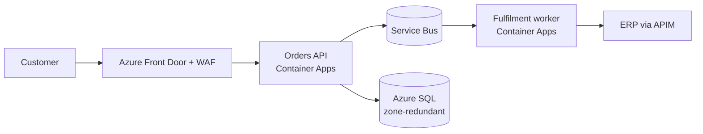

# Architecture Decision Records and Diagrams

## Why it matters

Six months after go-live, someone asks "why did we use Cosmos DB instead of SQL?" or "why is everything private?" and nobody remembers. Undocumented decisions get re-litigated, reversed accidentally or copied without understanding. **Architecture decision records (ADRs)** capture significant decisions with context, options and consequences in a lightweight, versioned way. **Diagrams** communicate structure to different audiences; the **C4 model** and consistent Azure iconography keep them readable. Together they're the most durable architecture artefacts, and consultants' deliverables are judged by them.

## Key concepts

### ADRs

| Element | Content |
|---|---|
| **Title and ID** | ADR-012: Use Azure Container Apps for API hosting |
| **Status** | Proposed, accepted, deprecated, superseded by ADR-xxx |
| **Context** | Forces: requirements, constraints, assumptions, risks |
| **Options considered** | With pros/cons per WAF pillar |
| **Decision** | What and why |
| **Consequences** | Positive and negative impacts, trade-offs, follow-up actions |
| **Date, deciders** | Accountability |

Principles (Microsoft Well-Architected guidance): record decisions when they're made, keep ADRs immutable (supersede rather than edit), store them with the code (`docs/adr/`), include trade-offs and confidence level, and link to requirements and evidence.

What deserves an ADR: anything costly to reverse or affecting multiple teams (platform choices, data stores, tenancy model, identity patterns, network topology, AI model and orchestration choices, build vs buy).

### The C4 model

| Level | Shows | Audience |
|---|---|---|
| **1. System context** | The system, users and external systems | Everyone, executives |
| **2. Container** | Applications and data stores (deployable units) and their interactions | Architects, developers, operations |
| **3. Component** | Components inside a container | Developers |
| **4. Code** | Classes/functions (rarely needed) | Developers |

Supplementary diagrams: **deployment** (Azure resources, regions, zones, networks), **dynamic/sequence** (request flows, failover), **data flow** (classification, trust boundaries for threat modelling).

### Azure diagram conventions

- Use the official **Azure architecture icons** (downloadable SVG set) at consistent sizes.
- Show **regions, zones, VNets, subnets, private endpoints** and **trust boundaries** explicitly in deployment views.
- Label flows with protocol and purpose; number steps in dynamic views.
- Include a legend, title, version and date.
- Keep diagrams in source control (draw.io XML, diagrams-as-code such as Structurizr, Mermaid or PlantUML) so they evolve with the system.

### Decision logs and architecture repositories

Index of ADRs, open questions and risks; link from the README of the architecture repository; review in architecture forums.

## How it works on Azure

ADR template (Markdown):

```markdown
# ADR-012: Use Azure Container Apps for API hosting

- Status: Accepted (2026-11-20); supersedes ADR-004
- Deciders: Lead architect, platform lead, security architect
- Confidence: High

## Context
Six APIs with spiky traffic, team of five without Kubernetes expertise; need private networking, scale to zero for non-prod, Dapr for pub/sub. Landing zone allows Container Apps and AKS.

## Options
1. AKS: maximum control; requires platform skills and cluster operations.
2. Container Apps: managed, KEDA/Dapr built in, revisions for canary; fewer advanced networking options.
3. App Service: simplest; weaker event-driven scaling and microservice features.

## Decision
Container Apps (workload profiles, internal environment) because it meets requirements with the lowest operational burden.

## Consequences
+ Faster delivery, lower ops cost. – Some AKS-only features unavailable; revisit if service mesh is required (trigger: > 20 services).
Follow-up: ADR on observability (OpenTelemetry), cost review after 3 months.
```

Mermaid C4-style container diagram (renders in GitHub and many tools):



## Design decisions and trade-offs

| Decision | Guidance |
|---|---|
| **Granularity** | ADRs for significant decisions only; avoid documenting trivia. |
| **Format** | Markdown in Git for reviewability; publish to a wiki if needed. |
| **Diagram tooling** | Diagrams as code for versioning; draw.io for richer visuals; consistent icon sets. |
| **Audience** | Context diagrams for executives; deployment diagrams for operations/security. |
| **Governance** | Architecture review board reviews ADRs above a risk threshold. |

## Hands-on

1. Write three ADRs for a recent project using the template.
2. Draw C4 context and container diagrams for the same system.
3. Draw an Azure deployment diagram with regions, zones, VNets, private endpoints and trust boundaries using official icons.
4. Convert one diagram to Mermaid and store it in Git.
5. Create an ADR index and link it from the repository README.

## Security, cost and reliability notes

- **Sensitive details** (IP ranges, security gaps) in diagrams and ADRs need appropriate access control.
- **Security decisions** benefit most from ADRs because they're often questioned later.
- **Cost trade-offs** documented in ADRs help FinOps reviews.

## Common mistakes

| Mistake | Fix |
|---|---|
| Decisions only in meetings or chat | ADRs in Git |
| Editing old ADRs | Supersede with new ADRs |
| One giant diagram for all audiences | C4 levels and views |
| Inconsistent or homemade icons | Official Azure icons |
| Diagrams that drift from reality | Diagrams as code, reviewed with changes |

## Check yourself

1. What does an ADR contain?
2. Which decisions deserve ADRs?
3. Describe the four C4 levels.
4. What supplementary diagrams are useful?
5. What conventions improve Azure diagrams?
6. Why keep ADRs immutable?

<details>
<summary>Answers</summary>

1. Title/ID, status, context, options, decision, consequences, date and deciders (plus confidence and links).
2. Costly-to-reverse or cross-team decisions: platforms, data stores, tenancy, identity, networking, AI orchestration, build vs buy.
3. System context, container, component, code.
4. Deployment, dynamic/sequence and data flow diagrams.
5. Official icons, explicit regions/zones/networks/trust boundaries, labelled flows, legend/version/date, source control.
6. To preserve history; changes are recorded as new ADRs that supersede old ones.

</details>

## References

- [Architecture decision records (Well-Architected)](https://learn.microsoft.com/azure/well-architected/architect-role/architecture-decision-record)
- [Azure architecture icons](https://learn.microsoft.com/azure/architecture/icons/)
- [The C4 model](https://c4model.com/)
- [Azure Architecture Center guides](https://learn.microsoft.com/azure/architecture/guide/)
